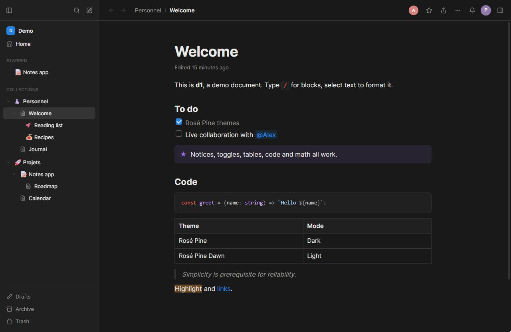
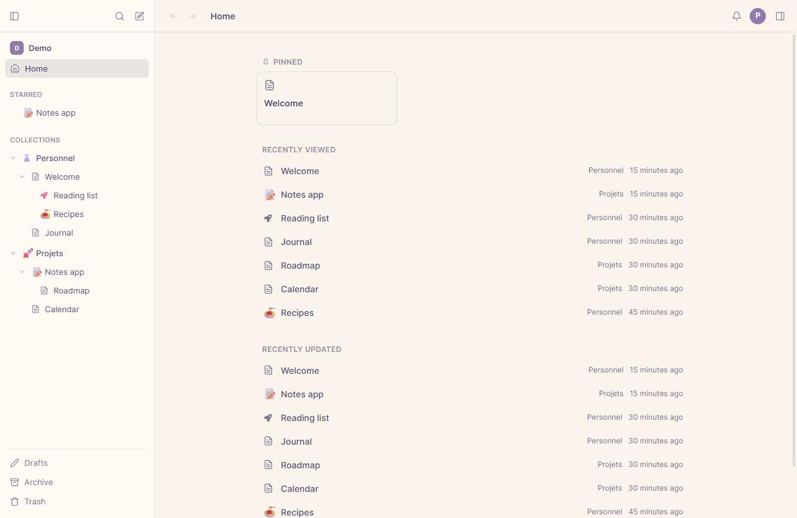
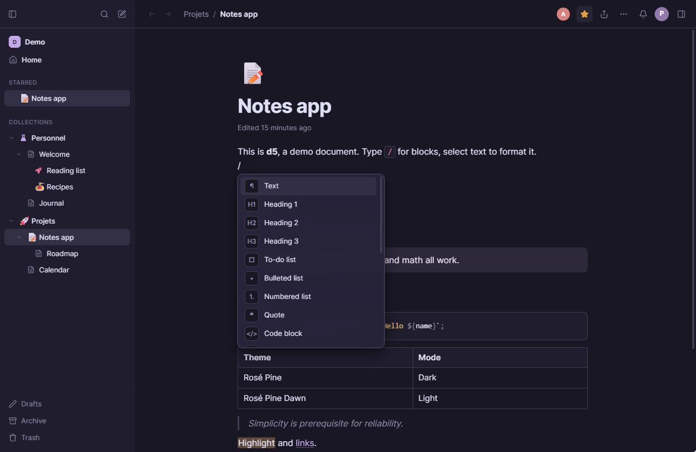
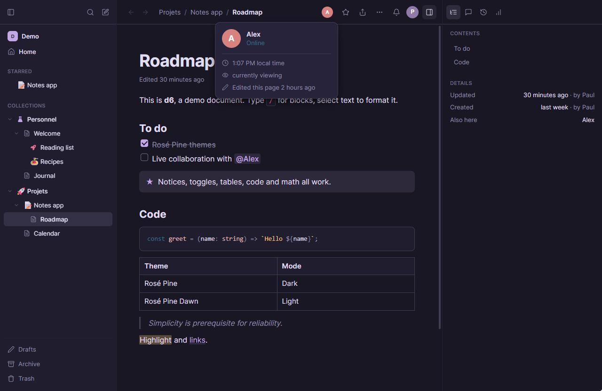
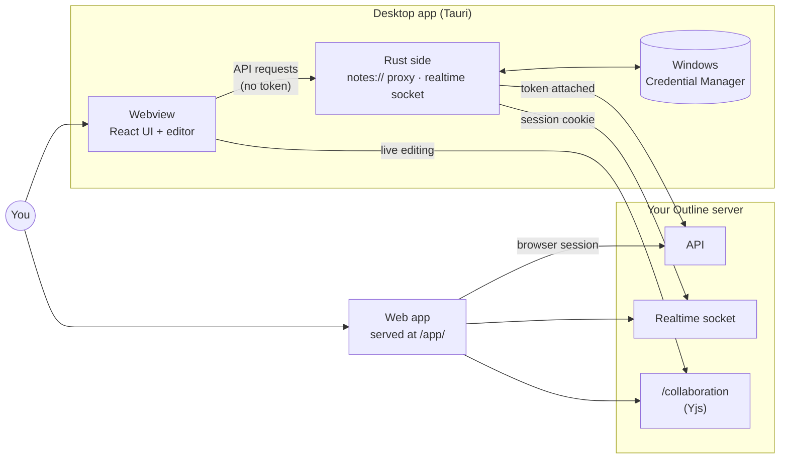

<div align="center">
  

  # Notes

  **A lightweight desktop and web client for a self-hosted [Outline](https://github.com/outline/outline) wiki, with live collaboration and offline support, using a fraction of the RAM and CPU of Outline's desktop app.**

  [](#️--disclaimer)
  [](LICENSE)
  [](https://tauri.app)
  [](https://react.dev)
  [](https://www.rust-lang.org)
  [](https://github.com/outline/outline)

  <br />
  
</div>


## ⚠️ • Disclaimer

This is an **unofficial** client: it isn't made or endorsed by Outline. It talks to Outline's own APIs and
collaboration server, and its editor schema is written to match Outline's so documents stay compatible. Outline
upgrades can change any of that. The app refuses to edit documents it can't fully represent rather than risk
overwriting them, but you should still keep backups. This is also a personal project, not a polished product:
expect missing pieces, sharp edges, and breaking changes.


## 📋 • Table of Contents

- [📖 • Overview](#--overview)
- [✨ • Features](#--features)
- [🖼️ • Screenshots](#️--screenshots)
- [🧩 • How it talks to Outline](#--how-it-talks-to-outline)
- [🛠️ • Tech Stack](#️--tech-stack)
- [🚀 • Getting Started](#--getting-started)
  - [Prerequisites](#prerequisites)
  - [Installation](#installation)
  - [Running Locally](#running-locally)
- [🧪 • Demo Mode](#--demo-mode)
- [📁 • Project Structure](#--project-structure)
- [🐳 • Web App (Docker)](#--web-app-docker)
- [📦 • Releases](#--releases)
- [⌨️ • Keyboard Shortcuts](#️--keyboard-shortcuts)
- [🤝 • Contributing](#--contributing)
- [🙌 • Credits](#--credits)
- [📄 • License](#--license)


## 📖 • Overview

Notes is an alternative interface for a self-hosted Outline wiki, with the same look as
[Calendar](https://github.com/PaulBayfield/calendar.bayfield.dev). It runs as a Tauri 2 desktop app (system
WebView2, no bundled Chromium) and as a web app served next to Outline.

Outline stays the server: storage, permissions, search and sharing are all Outline's. This app replaces only the
interface, so you can keep using Outline's own web app at the same time, and friends editing there show up live
here (and the other way round).

**Much lighter than Outline's desktop app.** Outline's app is built on Electron, so it ships and runs a full copy
of Chromium. Notes uses the WebView2 that's already part of Windows, with a small Rust backend, so it needs far
less RAM and CPU, starts faster, and the installer is a fraction of the size. It's comfortable to leave open all
day, even on a modest laptop.


## ✨ • Features

- **Sidebar:** collections, nested documents, starred documents and "Shared with me" (with Outline's icons); drag
  and drop to reorder or move documents; resizable by dragging its edge; home with recent documents
- **Live:** collaborative editing over Outline's own collaboration server (Yjs) with cursors and presence; the
  sidebar, titles and comments update as others change them
- **Editor:** `/` block menu, `@` mentions, `:` emoji, Markdown shortcuts (`#`, `-`, `- [ ]`, `>`, ```` ``` ````,
  `**bold**`…), Markdown paste, a formatting toolbar on selection, to-do lists, tables, notices, toggles, code
  blocks with syntax colours, math (KaTeX), Mermaid diagrams, images and file uploads (paste or drop)
- **Collections:** create and edit (name, Outline icon or any emoji, colour, access), drag to reorder; each
  collection's overview is an editable page (Markdown descriptions are converted), with pinned documents
- **Document menu like Outline's:** star, subscribe, templatize, duplicate, unpublish, archive, move, import, new
  nested document, pin (collection / home), comments, history (preview and restore versions), insights, present
  (slides split at headings and dividers), export (Markdown, HTML, TextBundle, JSON) / copy as Markdown, search & replace in document (`Ctrl+F`),
  heading numbering, embeds (YouTube, Vimeo, Loom, Figma, Google Docs…) and full width
- **Presence:** collaborators' avatars in the header; hover one for their role, local time, whether they're
  reading or editing, and their recent activity
- **Comments:** select text → 💬 (or `Ctrl+Alt+M`); threads, replies, edit, resolve, in the right panel
- **Navigation:** reopens the last page visited, search (`Ctrl+K`), contents panel, back/forward, archive/delete
  with undo; archived pages can be deleted too
- **Exports:** a collection (right-click it) or the whole workspace (Settings → Export) as Markdown, Open Knowledge
  Format, HTML, TextBundle or JSON, built by Outline in the background and downloaded from the app
- **Updates (desktop):** the app checks GitHub releases and offers new versions; the current version is in
  Settings → About
- **Themes:** System, Light, Dark, Rosé Pine, Rosé Pine Dawn. UI in French or English
- **Offline:** open documents are cached locally and sync when you're back


## 🖼️ • Screenshots

Taken in [Demo Mode](#--demo-mode).

| | |
|---|---|
|  |  |
| **Home:** pinned and recent documents (Rosé Pine Dawn) | **Editor:** the `/` block menu (Rosé Pine) |



**Presence:** hover a collaborator to see their local time and what they're doing, next to the contents and details panel.


## 🧩 • How it talks to Outline



- **Sign-in (desktop):** the app uses Outline's own desktop flow. It opens your server's SSO page with
  `?client=desktop` in a window of the app; once you're signed in, Outline hands back a one-time token, which the
  app exchanges for a session (valid 3 months), stored in Windows Credential Manager. If a provider refuses
  embedded windows (Google does), tick "Sign in with my browser instead": the browser then returns through an
  `outline://` link, which the app registers only at that moment (so it doesn't take that link type from the
  official Outline app otherwise).
- **Live updates (desktop):** Outline's realtime socket only accepts its session cookie, so the Rust side holds
  that connection ([`src-tauri/src/realtime.rs`](src-tauri/src/realtime.rs)) and forwards events to the window.
  The web build connects directly.
- **API (desktop):** the webview never holds the session token. Its requests go to a `notes://` protocol that the
  Rust side forwards to the server with the token attached ([`src-tauri/src/lib.rs`](src-tauri/src/lib.rs)). This
  also covers images and attachments, which need authentication.
- **Web:** served on Outline's own domain (see [Web App (Docker)](#--web-app-docker)), it uses your normal Outline
  browser session.
- **Collaboration:** the editor connects to `wss://<server>/collaboration` with the same protocol and editor
  version as Outline's web app. The schema in [`src/editor/schema.ts`](src/editor/schema.ts) mirrors Outline's
  node by node: the sync layer drops anything it can't represent, so a document containing unknown content is not
  opened (you get an "open in browser" button instead). If an Outline upgrade bumps the editor's major version,
  the server refuses the connection and the app says it needs an update; nothing gets overwritten.


## 🛠️ • Tech Stack

| Layer | Technology |
|---|---|
| Desktop shell | [Tauri 2](https://tauri.app) (system WebView2), Rust 2024 edition |
| Frontend | [React 19](https://react.dev), TypeScript, [Vite](https://vite.dev) |
| Editor | [ProseMirror](https://prosemirror.net), schema mirroring Outline's |
| Collaboration | [Yjs](https://yjs.dev) via [y-prosemirror](https://github.com/yjs/y-prosemirror) and [Hocuspocus](https://tiptap.dev/hocuspocus) |
| Offline cache | [y-indexeddb](https://github.com/yjs/y-indexeddb) |
| Rich content | [KaTeX](https://katex.org) (math), [Mermaid](https://mermaid.js.org) (diagrams), [refractor](https://github.com/wooorm/refractor) (syntax colours), [markdown-it](https://github.com/markdown-it/markdown-it) |
| Realtime (desktop) | [tokio](https://tokio.rs) + [tokio-tungstenite](https://github.com/snapview/tokio-tungstenite) |
| Web hosting | nginx in Docker, behind your reverse proxy |
| CI / CD | GitHub Actions (type-check & build, Docker image on `ghcr.io`, Windows installers) |


## 🚀 • Getting Started

### Prerequisites

- [Node.js](https://nodejs.org) ≥ 24 and npm
- For the desktop app: Rust and the MSVC C++ build tools, see <https://tauri.app/start/prerequisites/>
- A self-hosted [Outline](https://github.com/outline/outline) server (not needed for [Demo Mode](#--demo-mode))

### Installation

```sh
git clone https://github.com/PaulBayfield/notes.bayfield.dev.git
cd notes.bayfield.dev
npm install
```

### Running Locally

```sh
npm run tauri dev    # desktop app
npm run dev          # web UI on http://localhost:1430
npm run tauri build  # desktop installer → src-tauri/target/release/bundle/
```


## 🧪 • Demo Mode

Add `?demo` to the web UI's URL (<http://localhost:1430/?demo>) to run against sample data
([`src/lib/demo.ts`](src/lib/demo.ts)) instead of an Outline server. No sign-in is needed, and nothing is saved
between reloads.


## 📁 • Project Structure

```
notes.bayfield.dev/
├── .github/workflows/
│   ├── ci.yml                  # Type-check & build (web), opt-in Rust check, Docker build on PRs
│   ├── deployment.yaml         # Publishes the web image to ghcr.io on every push to main
│   └── release.yml             # Builds the Windows installers on version tags
├── docs/screenshots/           # README screenshots
├── public/                     # Favicon & touch icon
├── scripts/
│   └── gen-outline-icons.mjs   # Generates src/lib/outlineIcons.ts
├── src/                        # React app (shared by desktop and web)
│   ├── components/             # Sidebar, document view, comments, history, dialogs…
│   ├── editor/                 # ProseMirror editor
│   │   ├── schema.ts           # Mirrors Outline's schema node by node
│   │   ├── collab.ts           # Yjs connection to Outline's collaboration server
│   │   └── …                   # Markdown, menus, input rules, Mermaid, find & replace…
│   └── lib/                    # API client, auth, realtime, i18n, settings, demo data
├── src-tauri/                  # Desktop shell (Rust)
│   └── src/
│       ├── lib.rs              # notes:// protocol, sign-in, token storage
│       ├── realtime.rs         # Outline realtime socket, forwarded to the window
│       └── shell.rs
├── Dockerfile                  # Web build served by nginx under /app/
├── docker-compose.yml
└── nginx.conf
```


## 🐳 • Web App (Docker)

The web build has to live on Outline's origin to use its session cookie, under a path such as `/app/`:

```sh
docker compose up -d --build     # serves the build on :8788 at /app/
```

A prebuilt image is also published to `ghcr.io/paulbayfield/notes.bayfield.dev` on every push to `main`
(tagged `latest` and by version, see [`deployment.yaml`](.github/workflows/deployment.yaml)).

Then route `https://notes.bayfield.dev/app/` to `localhost:8788` in your reverse proxy, **before** the catch-all
rule that sends everything to Outline. For example, with Caddy:

```
notes.bayfield.dev {
    handle /app/* {
        reverse_proxy localhost:8788
    }
    handle {
        reverse_proxy localhost:3000   # Outline
    }
}
```

or nginx: `location /app/ { proxy_pass http://127.0.0.1:8788; }` next to the existing `location /`.

Open `https://notes.bayfield.dev/app/`. If you're not signed in to Outline, the page links to its login.


## 📦 • Releases

Bump `version` in `package.json`, commit, then push a matching tag:

```sh
git tag v0.2.0 && git push origin v0.2.0
```

[`release.yml`](.github/workflows/release.yml) builds the Windows installers and attaches them to a draft GitHub
release. Once you publish it, the desktop app offers it to everyone (it checks the latest published release). The web app is published as a container image on every push to `main`, see
[Web App (Docker)](#--web-app-docker).


## ⌨️ • Keyboard Shortcuts

| Key | Action |
|---|---|
| `Ctrl+K` / `Ctrl+P` | Search (with text selected in the editor, `Ctrl+K` adds a link) |
| `Ctrl+N` | New document |
| `Ctrl+B` (or `\`) · `.` | Toggle sidebar · right panel (in the editor, `Ctrl+B` makes selected text bold) |
| `Alt+←` / `Alt+→` | Back / forward |
| `Ctrl+,` | Settings |
| `/` · `@` · `:` | Blocks · mentions · emoji |
| `Ctrl+B` `I` `U` `D` `E` | Bold, italic, underline, strikethrough, code |
| `Ctrl+Alt+1…4` | Headings |
| `Ctrl+Shift+7/8/9` | Numbered / bulleted / to-do list |
| `Ctrl+Alt+M` | Comment on the selection |
| `Ctrl+Enter` | Check a to-do, or leave a code block / notice / quote |
| `Ctrl+Click` | Open a link |


## 🤝 • Contributing

This is a personal, single-maintainer project (see [Disclaimer](#️--disclaimer)), so there's no formal
`CONTRIBUTING.md` or process. Issues and pull requests are still welcome if something's broken or you have a
suggestion.


## 🙌 • Credits

| Person | Role |
|---|---|
| [Paul Bayfield](https://github.com/PaulBayfield) | Creator & maintainer |

Notes also builds on:

| Project | Used for |
|---|---|
| [Outline](https://github.com/outline/outline) (BSL 1.1) | The server: storage, permissions, search, sharing, collaboration. No Outline code is included here |
| [outline-icons](https://github.com/outline/outline-icons) (BSD-3-Clause) and [Font Awesome Free](https://fontawesome.com) (CC BY 4.0) | Collection and document icons, generated into [`src/lib/outlineIcons.ts`](src/lib/outlineIcons.ts) by [`scripts/gen-outline-icons.mjs`](scripts/gen-outline-icons.mjs), following Outline's icon list |
| [Rosé Pine](https://rosepinetheme.com) | The Rosé Pine and Rosé Pine Dawn themes |


## 📄 • License

Notes is licensed under the [AGPL 3.0](LICENSE).

```
Notes
Copyright (C) 2026 Paul Bayfield

This program is free software: you can redistribute it and/or modify
it under the terms of the GNU Affero General Public License as published by
the Free Software Foundation, either version 3 of the License, or
(at your option) any later version.

This program is distributed in the hope that it will be useful,
but WITHOUT ANY WARRANTY; without even the implied warranty of
MERCHANTABILITY or FITNESS FOR A PARTICULAR PURPOSE.  See the
GNU Affero General Public License for more details.

You should have received a copy of the GNU Affero General Public License
along with this program.  If not, see <http://www.gnu.org/licenses/>.
```
